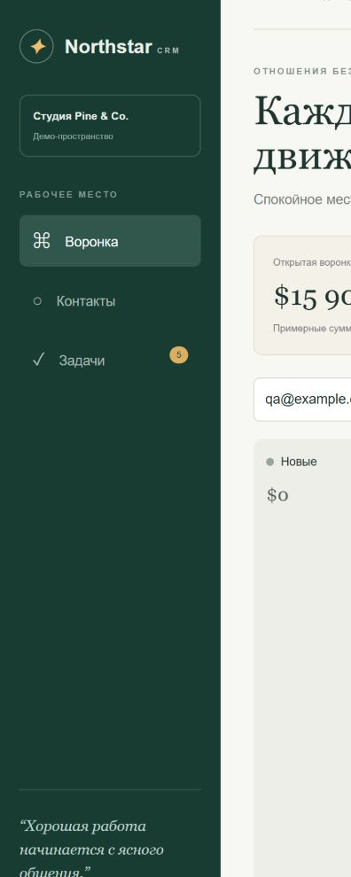

# Northstar MiniCRM

A bilingual local CRM portfolio demo for a small creative studio. Built with Next.js, React and TypeScript with Codex assistance. All people, companies, values and activities are fictional.

## Features

- Four-stage opportunity pipeline with explicit stage movement.
- Create and edit leads with validated contact, priority, value and next action.
- Searchable contact directory and follow-up task list.
- English/Russian interface with saved language preference.
- Versioned localStorage persistence that rejects malformed records.
- Responsive kanban layout for desktop, tablet and mobile.

## Run

Use Node.js 24 and pnpm. Run `pnpm install --frozen-lockfile`, then `pnpm dev`, and open http://127.0.0.1:3102. Windows users can run `Start-MiniCRM.ps1` after installing dependencies.

Validation is shared by writes and stored-data decoding. No accounts, server database, real email delivery, payments or analytics exist. Do not enter real personal information. A production CRM would require authentication, server-side authorization and validation, transactional storage, backups, audit history and privacy controls.

Verify with `pnpm test`, `pnpm typecheck` and `pnpm build`. Set `NEXT_TELEMETRY_DISABLED=1` when building if desired.
